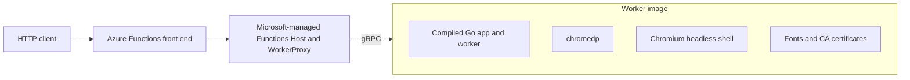

<!--
---
name: Generate PDFs with Go and Chromium on Azure Functions Flex Consumption
description: >-
  Build a Linux AMD64 Azure Functions Go worker image that uses chromedp and
  OS-installed Chromium to generate PDFs from bounded HTML input.
page_type: sample
languages:
- go
- dockerfile
- powershell
products:
- azure
- azure-functions
- azure-container-registry
urlFragment: functions-flex-byoc-go-html-to-pdf
---
-->

# Generate PDFs with Go and Chromium on Azure Functions Flex Consumption

This sample builds an Azure Functions Go worker image that uses
[chromedp](https://github.com/chromedp/chromedp) and OS-installed Chromium to
generate PDF documents.

Use the sample to:

- verify the original Go worker with `GET` and `POST /api/hello`;
- render a built-in invoice with `GET /api/html-to-pdf`;
- render bounded raw HTML with `POST /api/html-to-pdf`.

> [!IMPORTANT]
> Azure Functions Go worker-image support and the Go worker SDK used by this
> sample are previews. Cloud deployment currently requires a subscription and
> region enabled for the preview. The public Azure CLI does not create this
> internal Stage configuration directly, so the validated deployment guide uses
> Azure Resource Manager calls. Do not present this path as generally available
> until the preview is exposed through supported public tooling.

## Architecture



The final image contains only the customer-owned Go worker and its OS
dependencies. The Functions Host and WorkerProxy remain outside the image on
Microsoft-managed infrastructure.

## Features

- Linux AMD64 worker-only container image
- Direct `/home/site/wwwroot/app` entrypoint
- Go worker SDK `v0.7.0-preview`
- OS-installed Chromium headless shell and fonts
- Non-root UID/GID `10001:10001`
- Chromium sandbox enabled
- One browser render at a time
- 256 KiB HTML input limit
- 20-second render timeout
- 20-page and 8 MiB PDF limits
- JavaScript disabled
- External HTTP, HTTPS, file, FTP, WebSocket, and secure WebSocket resources
  blocked
- Real in-container Chromium integration test

## Getting started

### Prerequisites

To build and test the sample locally, install:

- [Git](https://git-scm.com/downloads)
- [Docker Desktop](https://docs.docker.com/desktop/) with Linux containers and
  Linux AMD64 build support
- Optional: [Go 1.26](https://go.dev/dl/) to run tests without Docker

To deploy the preview to Azure, you also need:

- PowerShell 7.4 or later
- Azure CLI 2.92 or later
- an Azure subscription enabled for the Flex Consumption worker-image preview
  in North Central US (Stage)
- permission to create resource groups, storage, Application Insights, Flex
  Consumption plans and apps, Azure Container Registry resources, scope maps,
  and tokens

### Clone the repository

```shell
git clone https://github.com/MadhuraBharadwaj-MSFT/flex-byoc-go-html-to-pdf.git
cd flex-byoc-go-html-to-pdf
```

### Run the source tests

With Go 1.26 installed:

```shell
go test -count=1 ./...
go vet ./...
```

Or run the checks in the Go builder image:

```shell
docker run --rm --platform linux/amd64 \
  --mount "type=bind,source=$PWD,target=/src" \
  --workdir /src \
  golang:1.26-bookworm \
  sh -c 'go test -count=1 ./... && go vet ./...'
```

### Run the Chromium integration test

Build the integration target:

```shell
docker build \
  --platform linux/amd64 \
  --target integration \
  --tag flex-byoc-go-html-to-pdf:integration \
  .
```

Docker Desktop's default seccomp profile can block Chromium namespace creation.
This test-only allowance keeps Chromium's own sandbox enabled:

```shell
docker run --rm \
  --platform linux/amd64 \
  --security-opt seccomp=unconfined \
  --env RUN_CHROMIUM_INTEGRATION=1 \
  --env PDF_OUTPUT_PATH=/evidence/integration.pdf \
  --mount "type=bind,source=$PWD,target=/evidence" \
  --entrypoint /bin/sh \
  flex-byoc-go-html-to-pdf:integration \
  -c '/tmp/pdf.test -test.v -test.run TestChromiumRendererIntegration'
```

The test verifies that:

- the process runs as UID `10001`;
- no Chromium sandbox-disabling argument is present;
- external page resources make zero requests;
- the output starts with `%PDF-` and contains `%%EOF`.

### Build the final worker image

```shell
docker build \
  --platform linux/amd64 \
  --target final \
  --tag flex-byoc-go-html-to-pdf:latest \
  .
```

The final image is a worker image, not a standalone web server. It does not
expose an HTTP port. HTTP requests flow through the platform Functions Host and
WorkerProxy.

## Deploy to Azure

If your subscription is enabled for the preview, follow
[Deploy the sample to North Central US (Stage)](docs/deploy-stage.md).

The guide provides the complete validated sequence to:

1. create isolated Azure resources;
1. build and push an immutable Linux AMD64 image;
1. create an ordinary Go `1.0` Flex app;
1. convert the app to a digest-pinned Registry deployment;
1. verify the greeting and PDF endpoints;
1. stop or delete the resources.

This repository intentionally does not include an `azd up` path. The current
public `azd` and Azure CLI surfaces do not represent the validated internal
Stage Registry conversion. Adding an unvalidated template would make the sample
look easier to deploy while giving customers a path that does not work.

## Invoke the deployed app

Set the endpoint from the `defaultHostName` returned by Azure Resource Manager:

```shell
ENDPOINT="https://<function-app-hostname>/api"
```

Verify the original Go worker:

```shell
curl --fail --show-error "$ENDPOINT/hello"
```

Expected response:

```text
Hello from the BYOC Go worker.
```

Download the built-in invoice:

```shell
curl --fail --show-error \
  "$ENDPOINT/html-to-pdf" \
  --output invoice-get.pdf
```

Render the included custom HTML:

```shell
curl --fail --show-error \
  --request POST \
  --header "Content-Type: text/html; charset=utf-8" \
  --data-binary @examples/custom.html \
  "$ENDPOINT/html-to-pdf" \
  --output invoice-post.pdf
```

Verify each PDF:

```shell
head -c 5 invoice-get.pdf
head -c 5 invoice-post.pdf
```

Both commands must print `%PDF-`. Open the files in a browser or PDF viewer to
complete the visual check.

## Customize the sample

- Edit `builtInInvoiceHTML` in [`handler.go`](handler.go) to change the built-in
  invoice.
- Edit [`examples/custom.html`](examples/custom.html) to test your own
  self-contained HTML.
- Change limits only after testing memory, latency, and abuse scenarios.
- Keep external resources blocked; embed required images and fonts as `data:`
  URLs.
- Keep each registry image immutable and deploy by manifest digest.

## How it works

The image starts the compiled worker directly:

```text
/home/site/wwwroot/app
  --functions-uri <platform value>
  --functions-worker-id <platform value>
  --functions-request-id <platform value>
  --functions-grpc-max-message-length <platform value>
```

The platform supplies all four arguments. The image sets only:

```text
FUNCTIONS_GO_DISABLE_HTTP_PROXY=1
```

It does not require `AzureWebJobsScriptRoot`,
`FUNCTIONS_APPLICATION_DIRECTORY`, `FUNCTIONS_WORKER_RUNTIME`, or
`FUNCTIONS_WORKER_RUNTIME_VERSION`.

For each PDF request, the renderer:

1. acquires the single render slot;
1. creates a temporary Chromium profile;
1. starts Chromium as the non-root app user;
1. blocks external resource protocols and disables JavaScript;
1. loads the bounded HTML from a local `data:` URL;
1. prints at most 20 pages;
1. validates the PDF signature and size;
1. cancels Chromium and removes the temporary profile.

## Preview Content-Type compatibility

In the validated Stage flow, externally sent `Content-Type` was delivered in
`RpcHttp.NullableHeaders`, while Go worker `v0.7.0-preview` copies only
`RpcHttp.Headers` into `http.Request`.

The handler therefore accepts a missing POST media type for this preview worker
path while continuing to reject any visible non-`text/html` media type. Clients
should still send `Content-Type: text/html`.

## Security

Rendering untrusted HTML invokes a complex browser parser and remains high
risk. Before using this sample in production, add platform authentication,
authorization, rate limiting, tenant isolation, abuse monitoring, and
workload-specific HTML sanitization.

The sample itself:

- runs the app and Chromium as non-root;
- installs and retains Chromium's sandbox;
- contains no sandbox-disable fallback;
- disables JavaScript;
- blocks external subresources;
- bounds input, page count, output, execution time, and concurrency;
- uses and removes a new browser profile for every request;
- contains no Azure or registry credentials.

For vulnerability reporting, see [SECURITY.md](SECURITY.md).

## Costs

Azure charges can include:

- Flex Consumption execution and memory;
- Azure Container Registry storage and image transfer;
- the Functions storage account;
- Application Insights ingestion and retention;
- Chromium CPU time and cold starts.

Stop the Function App when you want to retain the resources without accepting
requests. Delete the resource group when you no longer need the sample.

## Troubleshooting

### The image exposes no HTTP port

This is expected. It is a worker-only image. Use the `integration` target for a
local Chromium test and the Azure Functions endpoint for an end-to-end test.

### Chromium reports that no sandbox is available

Install the `chromium-sandbox` OS package, run the image as non-root, and verify
that the sandbox binary has mode `4755`. Do not add `--no-sandbox`. Docker
Desktop can require the documented test-only seccomp allowance.

### The app cannot pull the image

Verify the exact `tag@sha256:...` value, repository-scoped read permissions,
credential setting names, token expiry, ACR networking, and anonymous/admin
settings. Do not enable anonymous pull or the registry admin account as a
shortcut.

### The function is not indexed

Verify that:

- the image contains `/home/site/wwwroot/app`;
- the entrypoint runs that binary directly;
- `FUNCTIONS_GO_DISABLE_HTTP_PROXY=1` is present;
- the platform supplies all four worker arguments;
- the image contains no Functions Host or placeholder proxy.

### POST returns HTTP 415

Send `Content-Type: text/html`. If the preview host omits the header from the
Go `http.Request`, use the checked-in compatibility behavior rather than
weakening other request bounds.

## Clean up resources

The deployment guide includes exact scoped cleanup commands. Deleting the
sample resource group removes the Function App, plan, storage account,
Application Insights component, registry, token, scope map, and images created
by the guide.

## Resources

- [Go BYOC prototype guide](https://gist.github.com/gavin-aguiar/1e7d6dcd7cf4c7d1b8a3c5e255506eb8)
- [Azure Functions Flex Consumption](https://learn.microsoft.com/azure/azure-functions/flex-consumption-plan)
- [Azure Functions Go developer guide](https://learn.microsoft.com/azure/azure-functions/functions-reference-go)
- [Azure Container Registry documentation](https://learn.microsoft.com/azure/container-registry/)
- [chromedp documentation](https://pkg.go.dev/github.com/chromedp/chromedp)

## Contributing

For contribution requirements and validation commands, see
[CONTRIBUTING.md](CONTRIBUTING.md).

This project follows the [Microsoft Open Source Code of
Conduct](CODE_OF_CONDUCT.md).

## License

This sample is licensed under the [MIT License](LICENSE).
