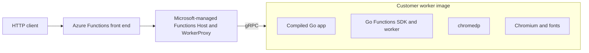

# Go and Chromium HTML-to-PDF on Azure Functions Flex Consumption

This preview sample runs a compiled Azure Functions Go worker in a customer worker image and uses [chromedp](https://github.com/chromedp/chromedp) with OS-installed Chromium to generate PDFs.

It demonstrates two anonymous HTTP operations:

- `GET /api/html-to-pdf` renders a polished built-in sample invoice.
- `POST /api/html-to-pdf` renders a raw `text/html` request body.

> [!IMPORTANT]
> This repository follows preview/prototype guidance. The worker SDK and the Flex Consumption customer worker-image experience can change before general availability. Anonymous HTTP authorization is used only to make the demo easy to invoke; it is not production guidance.

## What is different about this image

Flex Consumption runs the Functions Host and WorkerProxy on Microsoft-managed infrastructure. This repository builds only the customer-owned language worker and its dependencies.



The image intentionally does **not** contain the Functions Host, WorkerProxy, Core Tools, or a placeholder proxy. The module `github.com/azure/azure-functions-golang-worker` is compiled into the application binary. This differs from language models that copy a separate worker archive into the image.

The current prototype startup adapter translates platform-provided environment values into these native worker arguments:

```text
/home/site/wwwroot/app
  --functions-uri <uri>
  --functions-worker-id <id>
  --functions-request-id <id>
  --functions-grpc-max-message-length <bytes>
```

When the platform supplies all four arguments directly, the adapter can be removed and the image can use `/home/site/wwwroot/app` as its entrypoint.

## Versions and image contract

| Component | Version or contract |
|---|---|
| Go | `go.mod` declares `1.26.0`; the pinned builder currently provides `1.26.10` |
| Azure Functions Go SDK/worker | `v0.7.0-preview`, compiled into the app |
| chromedp | `v0.23.0` |
| Target | Linux AMD64 |
| Application directory | `/home/site/wwwroot` |
| Final image user | UID/GID `10001:10001` |
| Chromium | Debian Bookworm `chromium-headless-shell` OS package |

The final image sets the native runtime values required by the prototype:

```text
AzureWebJobsScriptRoot=/home/site/wwwroot
FUNCTIONS_WORKER_RUNTIME=native
FUNCTIONS_WORKER_RUNTIME_VERSION=1.0
FUNCTIONS_GO_DISABLE_HTTP_PROXY=1
```

`FUNCTIONS_APPLICATION_DIRECTORY` is not used because the Go worker indexes functions from compiled registrations. `WORKERPROXY__PRELAUNCHCONTEXT` is not part of this contract.

## Repository layout

```text
.
|-- cmd/rendercheck/          # Real Chromium smoke test used by the validation image
|-- docker/entrypoint.sh      # Temporary environment-to-argument adapter
|-- examples/custom.html      # Self-contained POST example
|-- internal/httpapi/         # HTTP validation and response handling
|-- internal/pdf/             # Chromium lifecycle, HTML hardening, and PDF output
|-- internal/sample/          # Built-in invoice HTML
|-- Dockerfile                # Worker-only Linux AMD64 image
|-- host.json
|-- local.settings.json.example
|-- main.go                   # Function registration and worker startup
|-- go.mod / go.sum
```

## Prerequisites

- Docker with BuildKit/buildx and Linux container support.
- Go 1.26 if you want to run source tests outside Docker.
- Azure Functions Core Tools with Go worker support for optional source-level host testing.
- An Azure subscription enabled for the Flex Consumption customer worker-image preview.
- Azure CLI bits that expose `--deployment-image` and `--deployment-image-auth-type` on `az functionapp create`.
- A supported Flex Consumption region, Azure Container Registry, and general-purpose storage account.

Confirm the preview CLI surface before creating resources:

```bash
az functionapp create --help
az functionapp deployment config set --help
```

Do not substitute legacy `--image`, `az functionapp config container`, or a complete Functions container image. Registry-backed Flex apps use a separate worker-image contract.

## Test the source

Run the unit tests:

```bash
go test ./...
```

The tests cover request validation, content type and size limits, timeout behavior, response headers, HTML hardening, and PDF signature/size checks.

To run the function through a local Functions Host:

```bash
cp local.settings.json.example local.settings.json
func start
```

Then invoke it:

```bash
curl --fail --show-error http://localhost:7071/api/html-to-pdf --output invoice.pdf
```

Core Tools validates the source-level Go worker experience. It does not validate the Flex worker-image boundary. The final image is not a standalone web server, so `docker run -p 8080:8080 ...` is not a valid endpoint test.

## Build and validate the Linux AMD64 image

The `validation` target contains a short-lived render-check binary. It launches the same non-root Chromium installation used by the final image and verifies that a PDF is produced.

```bash
docker buildx build \
  --platform linux/amd64 \
  --target validation \
  --tag flex-byoc-go-html-to-pdf:validation \
  --load .

docker run --rm \
  --cap-add SYS_ADMIN \
  flex-byoc-go-html-to-pdf:validation
```

Expected output resembles:

```text
render check passed: generated 45000 PDF bytes
```

The extra capability is for this local Docker smoke test so Chromium can create its sandbox namespaces. It is not baked into the image and does not disable Chromium's sandbox.

Build the final worker image:

```bash
docker buildx build \
  --platform linux/amd64 \
  --tag flex-byoc-go-html-to-pdf:0.1.0 \
  --load .
```

The Dockerfile pins the Dockerfile frontend, Go builder, and Debian runtime images by reviewed digest. Rebuild regularly for Chromium and OS security updates, review the new base digests before updating them, and keep each resulting application image digest immutable.

## Push to Azure Container Registry

Set placeholders for your environment:

```bash
RESOURCE_GROUP="<resource-group>"
LOCATION="<azure-region>"
FLEX_LOCATION="<supported-flex-region>"
STORAGE_ACCOUNT="<globally-unique-storage-account>"
ACR_NAME="<globally-unique-acr-name>"
FUNCTION_APP="<globally-unique-function-app>"
REPOSITORY="samples/flex-byoc-go-html-to-pdf"
TAG="0.1.0"
```

Create the shared resources if you do not already have them:

```bash
az group create --name "$RESOURCE_GROUP" --location "$LOCATION"

az storage account create \
  --resource-group "$RESOURCE_GROUP" \
  --name "$STORAGE_ACCOUNT" \
  --location "$LOCATION" \
  --sku Standard_LRS

az acr create \
  --resource-group "$RESOURCE_GROUP" \
  --name "$ACR_NAME" \
  --location "$LOCATION" \
  --sku Standard
```

Build, push, and resolve the immutable digest:

```bash
ACR_LOGIN_SERVER="$(az acr show --name "$ACR_NAME" --query loginServer --output tsv)"

az acr login --name "$ACR_NAME"

docker buildx build \
  --platform linux/amd64 \
  --tag "$ACR_LOGIN_SERVER/$REPOSITORY:$TAG" \
  --push .

DIGEST="$(az acr repository show \
  --name "$ACR_NAME" \
  --image "$REPOSITORY:$TAG" \
  --query digest \
  --output tsv)"

IMAGE="$ACR_LOGIN_SERVER/$REPOSITORY@$DIGEST"
echo "$IMAGE"
```

Use the `repository@sha256:...` value for deployment. Do not rely on a mutable tag: the platform does not track tag changes, and setting the same tag again does not guarantee a new pull.

Optionally confirm the manifest target:

```bash
az acr repository show \
  --name "$ACR_NAME" \
  --image "$REPOSITORY@$DIGEST" \
  --query "{digest:digest,os:os,architecture:architecture}"
```

The result must report Linux and AMD64.

## Create the Registry-backed Flex app

The current preview CLI creates the app with `functionAppConfig.deployment.storage.type = Registry`, omits `functionAppConfig.runtime`, and uses the `Recreate` site update strategy. The image provides the worker, so do not pass `--runtime` or `--runtime-version`.

Use the app's system-assigned identity to pull from ACR:

```bash
ACR_ID="$(az acr show --name "$ACR_NAME" --query id --output tsv)"

az functionapp create \
  --resource-group "$RESOURCE_GROUP" \
  --name "$FUNCTION_APP" \
  --storage-account "$STORAGE_ACCOUNT" \
  --flexconsumption-location "$FLEX_LOCATION" \
  --deployment-image "$IMAGE" \
  --deployment-image-auth-type SystemAssignedIdentity \
  --assign-identity '[system]' \
  --role AcrPull \
  --scope "$ACR_ID" \
  --instance-memory 2048 \
  --maximum-instance-count 2
```

The service accepting the configuration does not prove that the image exists or that the registry is reachable. Allow time for role propagation, then inspect the persisted configuration:

```bash
az functionapp deployment config show \
  --resource-group "$RESOURCE_GROUP" \
  --name "$FUNCTION_APP"

az functionapp show \
  --resource-group "$RESOURCE_GROUP" \
  --name "$FUNCTION_APP" \
  --query properties.functionAppConfig
```

For a new image, push a new tag, resolve its digest, and update both the image and authentication type:

```bash
az functionapp deployment config set \
  --resource-group "$RESOURCE_GROUP" \
  --name "$FUNCTION_APP" \
  --deployment-image "$ACR_LOGIN_SERVER/$REPOSITORY@sha256:<new-digest>" \
  --deployment-image-auth-type SystemAssignedIdentity
```

Other preview authentication forms are `UserAssignedIdentity`, `Basic`, and `Anonymous`. Prefer managed identity. `UserAssignedIdentity` also requires `--deployment-image-identity`. Basic authentication requires `--deployment-image-username-setting` and `--deployment-image-password-setting`, which name app settings rather than containing credentials. Anonymous registry pull is suitable only for intentionally public images.

## Invoke and verify

Set the endpoint:

```bash
ENDPOINT="https://$FUNCTION_APP.azurewebsites.net/api/html-to-pdf"
```

Download the built-in invoice:

```bash
curl --fail --show-error "$ENDPOINT" --output invoice.pdf
```

Render the included custom HTML:

```bash
curl --fail --show-error \
  --request POST \
  --header "Content-Type: text/html; charset=utf-8" \
  --data-binary @examples/custom.html \
  "$ENDPOINT" \
  --output custom.pdf
```

Both responses should have:

```text
Content-Type: application/pdf
Content-Disposition: attachment; filename="..."
```

Verify the PDF signature:

```bash
head -c 5 invoice.pdf
```

Expected output:

```text
%PDF-
```

Open the file in a PDF viewer for the final visual check.

## Request behavior and limits

| Behavior | Value |
|---|---|
| Accepted POST type | `text/html`, optional charset |
| Maximum HTML body | 1 MiB |
| Render timeout | 30 seconds |
| Concurrent renders per worker process | 1 |
| Maximum generated PDF | 20 MiB |
| External HTTP/file resources | Blocked |
| JavaScript and active embedded content | Removed or blocked |

Use inline CSS and embed images or fonts as `data:` URLs. There is deliberately no endpoint that fetches an arbitrary URL.

## Troubleshooting

### The image runs locally but no HTTP port opens

That is expected. This is a worker-only image. The Microsoft-managed Functions Host receives HTTP traffic and communicates with the image over the worker protocol.

### The startup adapter reports a missing worker ID

Direct `docker run` does not provide the platform worker context. Use the `validation` target for a local Chromium smoke test. Use Core Tools for source-level HTTP testing.

### The app cannot pull the image

- Confirm the deployed value is the exact `repository@sha256:digest`.
- Confirm the manifest is Linux AMD64.
- Confirm the Function App identity has `AcrPull` on the registry.
- Allow time for role assignment propagation.
- Confirm ACR networking permits the platform pull path.

### The function is not indexed

- Confirm the image contains `/home/site/wwwroot/app`.
- Confirm the four native runtime environment variables are unchanged.
- Confirm the entrypoint eventually executes the app with the four worker arguments.
- Do not add a Functions Host, WorkerProxy, placeholder proxy, or custom-handler configuration.

### Chromium fails to start

- Build for `linux/amd64`.
- Confirm `/usr/bin/chromium-headless-shell` exists in the final image.
- Keep the image user non-root and `/home/site`, `/tmp`, and the cache directory writable.
- Run the `validation` target before pushing.
- Do not enable `CHROMIUM_NO_SANDBOX=1` unless your environment requires it and you have accepted the security tradeoff.

### POST returns an error

- `400`: the body is empty or unreadable.
- `413`: the HTML exceeds 1 MiB.
- `415`: `Content-Type` is not `text/html`.
- `504`: Chromium did not finish within 30 seconds.

### External styles, images, or script-generated content are missing

This sample intentionally blocks network access and active content. Make the document self-contained and server-render the final HTML before posting it.

## Security

Rendering untrusted HTML invokes a complex browser parser and must be treated as high risk even with mitigations.

This sample:

- runs the final image and Chromium as non-root;
- keeps Chromium's sandbox enabled by default;
- limits input, output, concurrency, and execution time;
- removes scripts, frames, plugins, refresh redirects, external links, event handlers, and external URL attributes;
- injects a restrictive Content Security Policy;
- forces browser traffic through a non-listening local proxy so external requests fail;
- returns fixed safe filenames;
- includes no credentials in the repository or image.

For production, add platform authentication and authorization, rate limiting, tenant isolation, abuse monitoring, and stricter business-specific HTML validation. Keep Chromium, the base image, Go modules, and the worker SDK patched. Rebuild and redeploy by immutable digest after every security update.

Anonymous function authorization in this repository is demo-only. Do not expose this endpoint publicly for arbitrary users.

## Cost considerations

This sample can incur charges for:

- Flex Consumption execution, memory, and any always-ready instances;
- Azure Container Registry storage and transfer;
- the Function App storage account;
- Application Insights or other logging destinations;
- repeated Chromium cold starts and CPU-intensive PDF renders.

Delete unused images and resources, and choose memory and maximum instance count based on measured PDF workload behavior.

## Cleanup

Delete only the Function App:

```bash
az functionapp delete \
  --resource-group "$RESOURCE_GROUP" \
  --name "$FUNCTION_APP"
```

If the resource group was created only for this sample, remove the entire group:

```bash
az group delete --name "$RESOURCE_GROUP" --yes --no-wait
```

Deleting the resource group also deletes its registry, images, storage account, logs, and any other resources it contains.

## License

This sample is licensed under the [MIT License](LICENSE).
